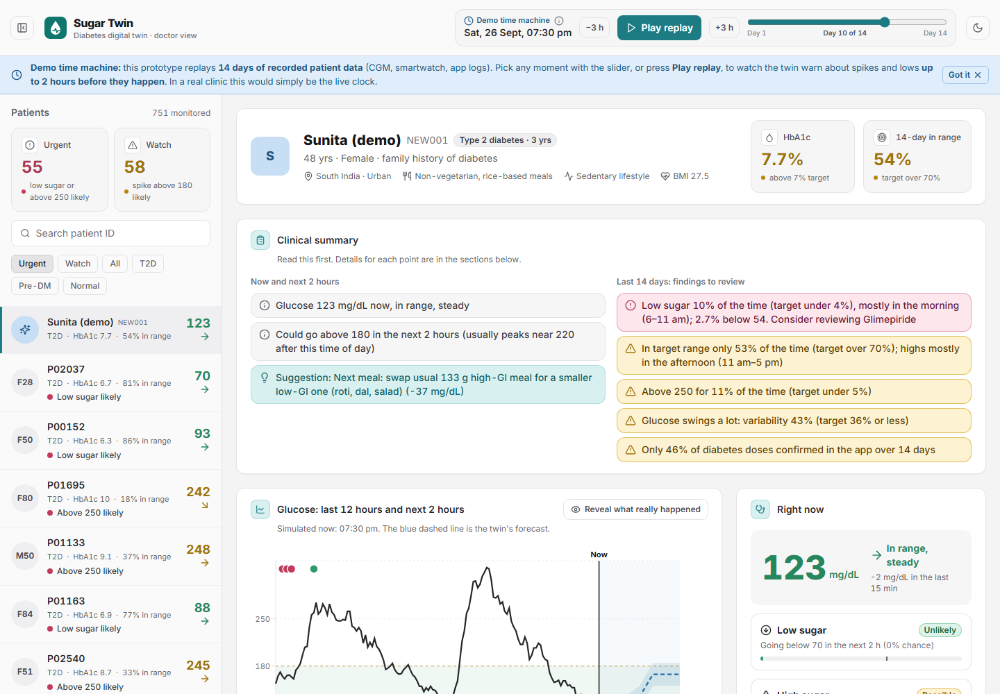
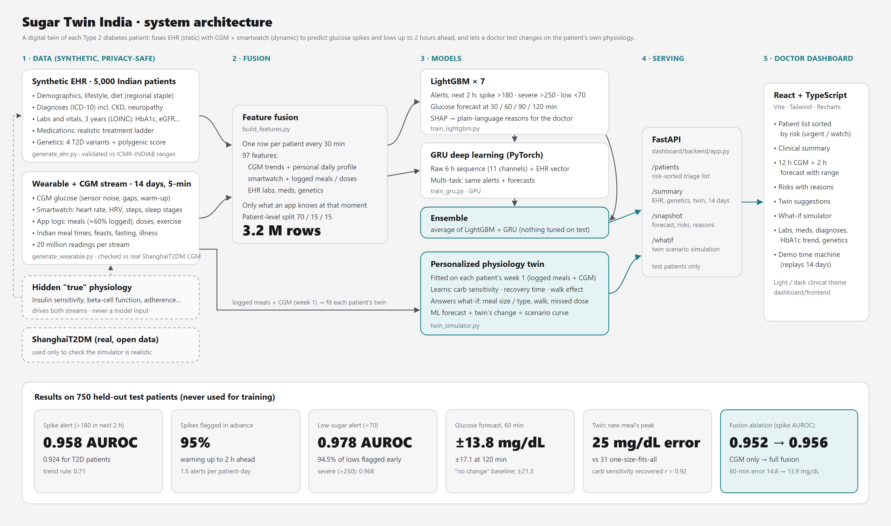
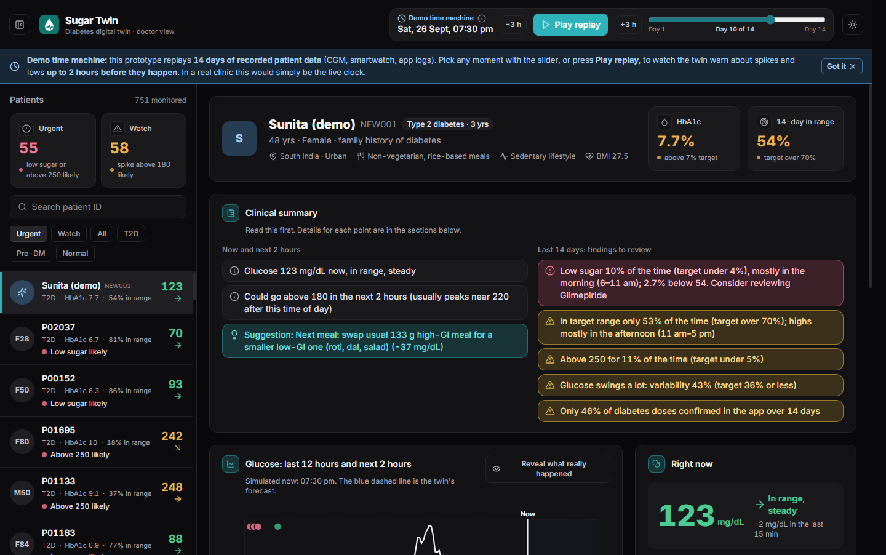
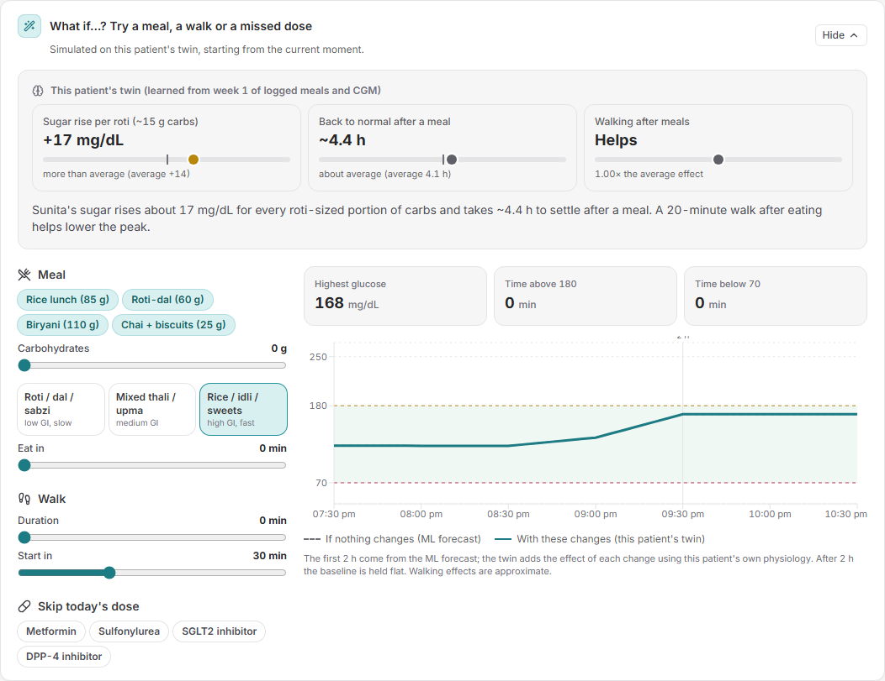
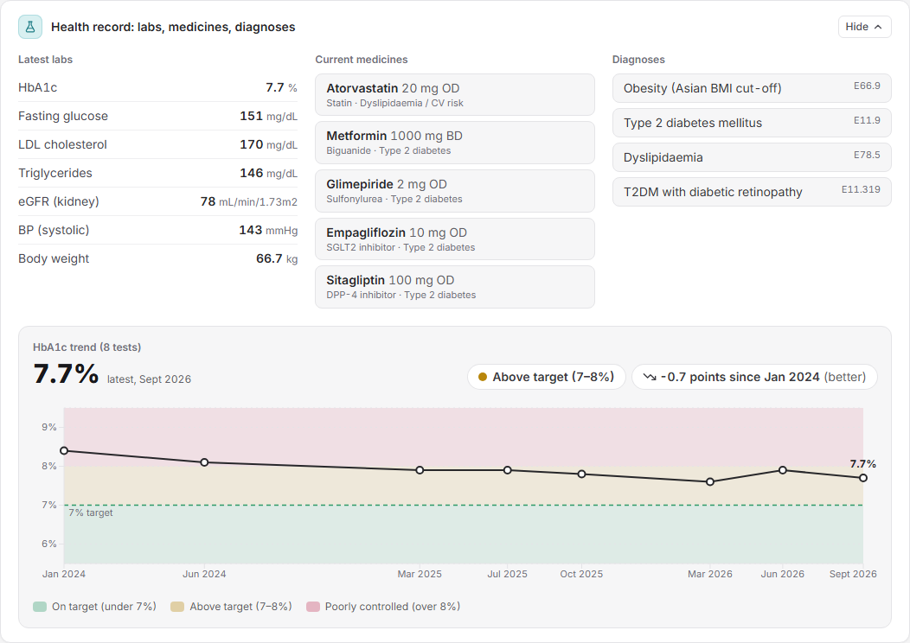
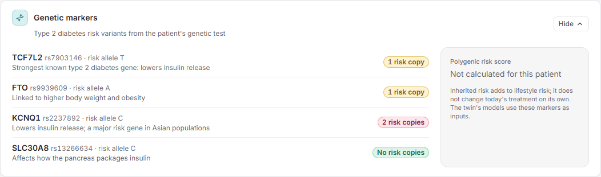

# Sugar Twin India: a Digital Twin that Predicts Glucose Spikes Before They Happen

> **Happiest Health Digital Twin Challenge 2026** · Reimagining and Reforming Healthcare in India Summit, Bengaluru
> Team **guptaaayush0908** · Maharaja Agrasen Institute of Technology

A virtual replica of each Type 2 diabetes patient that **fuses electronic health records (static) with CGM and smartwatch data (dynamic)**,
predicts **glucose spikes and lows up to 2 hours in advance**, and lets a doctor **test a meal, a walk or a missed dose on the patient's own physiology** before advising them.

| | |
|---|---|
| 📽️ Demo video | **[link to be added]** |
| 📊 Presentation | [docs/Sugar_Twin_India_presentation.pdf](docs/Sugar_Twin_India_presentation.pdf) · [.pptx](docs/Sugar_Twin_India_presentation.pptx) |
| 🧭 Architecture diagram | [docs/architecture.pdf](docs/architecture.pdf) · [.png](docs/architecture.png) |
| 🎬 Video script | [docs/VIDEO_SCRIPT.md](docs/VIDEO_SCRIPT.md) |



---

## 1. Team

Team name: **guptaaayush0908**

| Name | Role | Institution |
|---|---|---|
| **Aayush Gupta** | Team leader | Maharaja Agrasen Institute of Technology |
| **Dhruv Gandhi** | Team member | Maharaja Agrasen Institute of Technology |
| **Divyansh Singh** | Team member | Maharaja Agrasen Institute of Technology |

College: **Maharaja Agrasen Institute of Technology (MAIT), Delhi**

## 2. Problem statement and healthcare use case

India has an estimated **101 million people with diabetes** (ICMR-INDIAB 2023), and most of them see a doctor every few months.
Between visits, glucose control is invisible: post-meal spikes from rice-heavy meals, late dinners, festivals, missed doses and illness
drive long-term damage, and dangerous lows on sulfonylureas or insulin often go unnoticed until they happen.

Continuous glucose monitors and smartwatches now generate this data, but a doctor cannot read 288 readings a day for hundreds of patients,
and a CGM alone only shows what **already** happened.

**Use case.** A diabetologist monitors a panel of T2D patients remotely. The digital twin:
1. **Triage:** sorts all patients by risk right now, so the doctor sees who needs attention first.
2. **Early warning:** predicts a spike above 180 mg/dL, above 250 mg/dL or a low below 70 mg/dL **in the next 2 hours**, with plain-language reasons.
3. **Personalized advice:** a twin of each patient's physiology (learned from their own meals and CGM) simulates "what if they eat a smaller low-GI meal / walk 20 minutes / skip a dose", so advice is tested on *this* body before it is given.
4. **Context:** EHR labs, medicines, diagnoses, HbA1c trend and genetic risk in the same view.

Chosen condition: **Type 2 diabetes**, the most prevalent lifestyle disease in India.

## 3. What we built



| Layer | What | Code |
|---|---|---|
| **Static stream: EHR** | 5,000 synthetic Indian patients (3,000 T2D, 1,000 prediabetes, 1,000 normal): demographics, ICD-10 diagnoses, 3 years of LOINC labs and vitals, medications on a realistic treatment ladder, **genetic markers** (TCF7L2, FTO, KCNQ1, SLC30A8 + polygenic risk score) | [src/generate_ehr.py](src/generate_ehr.py) |
| **Dynamic stream: wearables** | 14 days at 5-minute resolution per patient: **CGM glucose, heart rate, HRV, steps, sleep stages**, plus app logs of meals, doses and exercise (20 M readings per stream). Indian meal times and dishes, feasts, fasting, illness, sensor noise and gaps | [src/generate_wearable.py](src/generate_wearable.py) |
| **One body, two streams** | Both streams are driven by the same hidden physiology (insulin sensitivity, beta-cell function, adherence…), so a patient's HbA1c, medicines and CGM curve agree. The hidden values are **never** model inputs | |
| **Fusion** | One row per patient every 30 min: 97 features from CGM, smartwatch, logged events and EHR, using only what an app would know at that moment. Patient-level 70/15/15 split | [src/build_features.py](src/build_features.py) |
| **ML models** | **LightGBM** (7 models: 3 alerts + 4 forecast horizons, SHAP explanations) and a **GRU** (PyTorch, raw 6 h sequence + EHR vector, multi-task); ensemble = their average | [src/train_lightgbm.py](src/train_lightgbm.py), [src/train_gru.py](src/train_gru.py) |
| **Physiology twin** | Per-patient carb sensitivity, recovery time and walking effect, learned from week 1; answers what-if questions | [src/twin_simulator.py](src/twin_simulator.py) |
| **Doctor dashboard** | FastAPI + React: triage list, forecast, risks with reasons, twin suggestions, what-if simulator, health record, genetics | [dashboard/](dashboard/) |

## 4. Results

All numbers are on **750 held-out test patients** whose data was never used for training or tuning.

### Adverse-event prediction (next 2 hours)

| Alert | AUROC (ensemble) | AUROC, T2D only | Simple baseline | Events flagged in advance |
|---|---|---|---|---|
| **Spike above 180** (main alert) | **0.958** | 0.924 | trend rule 0.71 | **95%** |
| Severe above 250 | 0.968 | 0.943 | trend rule 0.79 | |
| Low below 70 | 0.978 | 0.989 | trend rule 0.90 | 94.5% |

At an alert threshold set on validation patients for 80% sensitivity: spike PPV 0.75, about 1.5 alerts per patient-day.

### Glucose forecast

| Horizon | 30 min | 60 min | 90 min | 120 min |
|---|---|---|---|---|
| Mean absolute error (mg/dL) | **10.6** | **13.8** | **15.9** | **17.1** |
| "Glucose stays the same" baseline | 14.1 | 21.3 | 27.3 | 31.7 |

Clarke error grid zones A + B: 99%+ at every horizon.

### Does fusing the two streams help? ([results/fusion_ablation](results/fusion_ablation/report.html))

| Inputs | Spike AUROC | Spike AUROC (T2D) | 60-min error (mg/dL) |
|---|---|---|---|
| CGM only | 0.952 | 0.915 | 14.8 |
| CGM + smartwatch + app logs | 0.955 | 0.919 | 14.1 |
| CGM + EHR | 0.953 | 0.917 | 14.6 |
| **Full fusion** | **0.956** | **0.921** | **13.9** |

Each stream adds information and the full fusion is best for spikes and forecasts. Low-sugar prediction is driven almost entirely by the CGM itself.

### Personalized twin ([results/twin_simulator](results/twin_simulator/report.html))

| | Error predicting a new meal's peak rise (week 2) |
|---|---|
| One-size-fits-all physiology | 31.3 mg/dL |
| **Personalized twin** (learned from week 1) | **25.4 mg/dL** |

The learned carb sensitivity matches each synthetic patient's hidden true value with r = 0.92 (recovery time r = 0.71).

### Robustness and scenario tests

- **Robustness** ([results/robustness](results/robustness/report.html)), all 4 pass: works from day 1 (spike AUROC 0.955), without meal logging (0.955), without a smartwatch (0.956), and with a 10% noisier sensor (0.942).
- **Clinical scenarios** ([results/scenario_tests](results/scenario_tests/report.html)): 19 of 24 checks pass, including feasts, missed doses, illness, fasting on sulfonylureas and night-time lows.
  The 5 that fail are *what-if* checks on the ML models (e.g. "a walk should lower the forecast"): the models learn correlation, not cause and effect.
  **This is why the physiology twin answers what-if questions instead of the ML models.**
- **Brand-new patient** ([results/new_patient](results/new_patient/report.html)): "Sunita", created outside the dataset, gets 100% of her 48 spikes and 18 lows flagged in advance (mean warning about 100 minutes).
- **Meal announcement** ([results/meal_announcement](results/meal_announcement/report.html)): if patients tap "about to eat", spike AUROC rises to 0.975 with a meal plan.

### Honest limitations

- All patient data is **synthetic**. The simulator is validated against Indian literature ranges and real ShanghaiT2DM CGM data, but performance on real patients will be lower.
- The twin shares its equations with the simulator, so its recovery of hidden physiology is an upper bound.
- Low-sugar alerts are sensitive but not precise (PPV about 0.28): roughly 3 in 4 low alerts are false alarms.
- Warning times are measured on a 30-minute grid and capped at 120 minutes.

## 5. Doctor dashboard

| Light theme | Dark theme |
|---|---|
|  |  |

| What-if simulator on the patient's twin | Health record with HbA1c trend | Genetic markers |
|---|---|---|
|  |  |  |

- **Patient list** sorted by risk (urgent: low or above 250 likely; watch: spike likely).
- **Clinical summary**: what is happening now and the key 14-day findings, in plain language.
- **Glucose chart**: last 12 hours plus the 2-hour forecast with its likely range, meals and doses.
- **Right now**: risks with reasons from the model (SHAP), e.g. "usually peaks near 220 after this time of day".
- **What the twin suggests**: actions with their simulated effect; *Try it* opens them in the what-if simulator.
- **Dropdowns** for detail: what-if simulator, health record, genetic markers, model accuracy.
- **Demo time machine**: replays the 14 recorded days so you can watch alerts appear before spikes happen.
- Clinical colour rules: red only for critical, amber for caution, green for normal; light and dark themes.

## 6. Tech stack

| Area | Tools |
|---|---|
| Data generation and features | Python 3.13, NumPy, pandas, SciPy, PyArrow |
| Machine learning | LightGBM 4.7 (with SHAP contributions), PyTorch 2.14 (GRU), scikit-learn |
| Physiology twin | Custom two-compartment gut absorption + glucose excursion model, per-patient least-squares fitting with shrinkage |
| Backend | FastAPI, Uvicorn |
| Frontend | React 19, TypeScript, Vite, Tailwind CSS 4, Recharts, lucide-react |
| Reports | Matplotlib (HTML reports in `results/`) |

## 7. Run it

Requirements: Python 3.11–3.13, Node 18+, about 16 GB RAM for the feature build.

```bash
pip install -r requirements.txt -r dashboard/backend/requirements.txt
python src/check_data.py          # confirms the committed data matches the reference
python src/build_features.py      # fused training table -> data/model/features.parquet (2-5 min)
```

**Dashboard** (two terminals, both starting from this project folder):
```bash
python -m uvicorn app:app --app-dir dashboard/backend --port 8000     # API, about 20 s to load
cd dashboard/frontend && npm install && npm run dev                    # open http://localhost:5173
```

**Reproduce the results** (optional; trained models are already in `models/`):
```bash
python src/train_lightgbm.py      # LightGBM, 30-90 min
python src/train_gru.py           # GRU, GPU recommended
python src/compare_models.py      # LightGBM vs GRU vs ensemble
python src/twin_simulator.py      # fit and validate the personal twins
python src/test_robustness.py && python src/test_scenarios.py
python src/experiment_fusion_ablation.py
```
Regenerate the data from scratch (identical output with the pinned versions): `python src/generate_ehr.py --n 5000 --seed 42` then `python src/generate_wearable.py`.
More detail: [TRAINING_LIGHTGBM.md](TRAINING_LIGHTGBM.md), [docs/data_dictionary.md](docs/data_dictionary.md), [docs/wearable_dictionary.md](docs/wearable_dictionary.md).

## 8. Repository structure

```
src/                  data generators, feature fusion, training, twin, tests and experiments
data/ehr, wearable    synthetic datasets + validation reports
data/new_patient      the demo patient "Sunita"
models/               trained LightGBM (.txt), GRU (.pt) and fitted twin parameters
results/              metrics.json + HTML report for every model and test
dashboard/backend     FastAPI service
dashboard/frontend    React doctor dashboard
docs/                 data dictionaries, architecture, presentation, video script, screenshots
```

## 9. Data privacy

Every patient record is synthetic, generated from statistical and clinical rules: no real patient data is used for training, in line with the
DPDP Act and HIPAA. The public, anonymised **ShanghaiT2DM** dataset (Zhao et al., *Scientific Data* 2023, CC BY 4.0) is used only to check
that the simulated CGM is realistic.

## 10. License

[MIT](LICENSE) © 2026 Team guptaaayush0908 (Aayush Gupta, Dhruv Gandhi, Divyansh Singh), Maharaja Agrasen Institute of Technology. Decision-support prototype, not a medical device.
